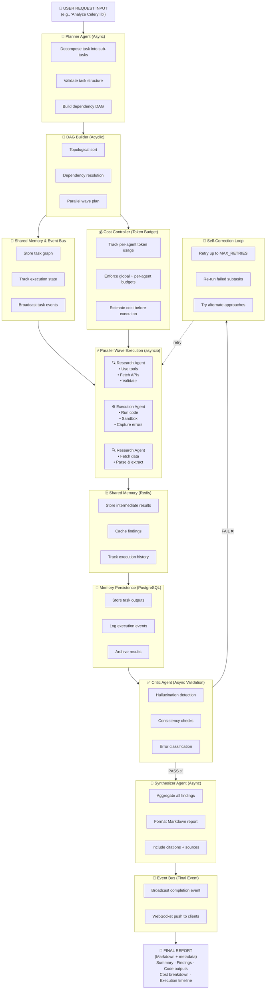

# MARES — Multi-Agent Research & Execution System

> A production-grade multi-agent orchestration system where specialized LLM agents collaborate to analyze, decompose, research, execute, and synthesize complex tasks — powered by async workflows, DAG-based dependency resolution, and real tool use.

## ✨ Features

- 🤖 **5 specialized agents** (Planner, Research, Execution, Critic, Synthesizer)
- 🔁 **DAG-based execution** with topological sort and parallel task scheduling
- ⚡ **Async parallel execution** with `asyncio` for independent tasks
- 🛠️ **Real tool use** (keyless web search via DuckDuckGo, optional SerpAPI/Brave, Python sandbox, file I/O, HTTP APIs)
- 🧠 **Two-tier memory** (per-agent + shared cross-agent memory, optional Redis backend)
- 🔄 **Self-correction loop** with critic-driven retries
- 🌐 **FastAPI** REST + WebSocket API
- 🐳 **Docker** + docker-compose deployment (runs Alembic migrations on start)
- 🧪 **49 test cases** (unit + integration)
- 📓 **10 Jupyter notebooks** for interactive learning

## 📁 Project Structure

See [`docs/ARCHITECTURE.md`](docs/ARCHITECTURE.md) for a deep dive.

```
mares-multi-agent-system/
├── mares/                  # Core library
│   ├── agents/             # 5 specialized agents
│   ├── orchestrator/       # DAG execution + parallel runner
│   ├── tools/              # Tool registry + executors
│   ├── memory/             # Agent + shared memory
│   ├── graph/              # DAG + dependency resolution
│   ├── llm/                # Multi-LLM factory
│   ├── communication/      # Message queue + event bus
│   ├── evaluation/         # Hallucination + consistency checks
│   ├── models/             # Pydantic data models
│   └── utils/              # Config, logger, retry, timeout
├── api/                    # FastAPI app
├── tests/                  # Unit + integration tests
├── examples/               # Runnable examples
├── notebooks/              # 10 interactive notebooks
├── docs/                   # Project documentation
├── config/                 # App configuration
└── .github/workflows/      # CI/CD pipelines
```

## 🚀 Quickstart

```bash
# Clone
git clone https://github.com/MohammadaminAlbooyeh/mares-multi-agent-system
cd mares-multi-agent-system

# Install
pip install -r requirements.txt

# Configure
cp .env.example .env
# Add your LLM key(s). Any OpenAI-compatible endpoint also works:
#   OPENAI_BASE_URL=https://openrouter.ai/api/v1
# Web search needs no key (DuckDuckGo); optionally set SERPAPI_API_KEY or BRAVE_API_KEY.

# Run an example
python -m examples.run_celery_analysis

# Or start the API server
uvicorn api.main:app --reload
```

### Web search providers

`SearchTool` is real by default and selects a provider with `SEARCH_PROVIDER`
(`auto` by default):

| Provider | Key required | Notes |
|----------|--------------|-------|
| `duckduckgo` | No | Keyless fallback, used by `auto` when no other key is set |
| `serpapi` | `SERPAPI_API_KEY` | Google organic results |
| `brave` | `BRAVE_API_KEY` | Brave Web Search API |
| `mock` | No | Deterministic fixtures for tests only |

There is no silent mock fallback in production: failed searches raise
`ToolError` (and the Research Agent degrades gracefully per sub-task).

### Persistence & memory

- `DATABASE_URL` enables PostgreSQL persistence for task runs and agent
  outputs (including cost/evaluation metadata).
- `MARES_MEMORY_BACKEND=redis` makes cross-agent shared memory use Redis;
  `memory` (the default) keeps it in-process.
- `docker compose up` applies `alembic upgrade head` automatically via the
  container entrypoint.

## 🤖 Agents

| Agent | Role | Input | Output |
|-------|------|-------|--------|
| **Planner** | Break task into sub-tasks + build DAG | Main task (string) | JSON task graph |
| **Research** | Research each sub-task using tools | Sub-task | Structured findings |
| **Execution** | Generate + run Python code | Code task | Execution result |
| **Critic** | Review + validate all outputs | Agent outputs | Error report |
| **Synthesizer** | Combine all into final report | All outputs | Final report (Markdown) |

## 🔁 Complete System Flow



<details>
<summary>ASCII version (click to expand)</summary>

```
┌─────────────────────────────────────────────────────────────────────────────┐
│                             USER REQUEST INPUT                              │
│                        (e.g., "Analyze Celery lib")                         │
└────────────────────────────┬────────────────────────────────────────────────┘
                             │
                             ▼
           ┌──────────────────────────────────┐
           │        PLANNER AGENT (Async)     │
           │  • Decompose task into sub-tasks │
           │  • Validate task structure       │
           │  • Build dependency DAG          │
           └──────┬───────────────────────────┘
                  │
                  ▼
       ┌──────────────────────────┐
       │   DAG BUILDER (Acyclic)  │
       │  ✓ Topological sort      │
       │  ✓ Dependency resolution │
       │  ✓ Parallel wave plan    │
       └──────┬───────────────────┘
              │
              ├─────────────────────────────────────────┐
              │     SHARED MEMORY & EVENT BUS           │
              │  • Store task graph                      │
              │  • Track execution state                 │
              │  • Broadcast task events                 │
              ├─────────────────────────────────────────┤
              │     COST CONTROLLER (Token Budget)      │
              │  • Track per-agent token usage          │
              │  • Enforce global + per-agent budgets   │
              │  • Estimate cost before execution       │
              └──────┬──────────────────────────────────┘
                     │
                     ▼
    ┌────────────────────────────────────────────┐
    │    PARALLEL WAVE EXECUTION (Asyncio)       │
    │  (Independent tasks run concurrently)      │
    └──────────────────────┬─────────────────────┘
                           │
          ┌────────────────┼────────────────┐
          │                │                │
          ▼                ▼                ▼
   ┌────────────┐  ┌────────────┐  ┌────────────┐
   │ RESEARCH   │  │ EXECUTION  │  │  RESEARCH  │
   │  AGENT     │  │   AGENT    │  │  AGENT     │
   │            │  │            │  │            │
   │ • Use tools│  │ • Run code │  │ • Use tools│
   │ • Fetch    │  │ • Sandbox  │  │ • Fetch    │
   │   APIs     │  │ • Timeout  │  │   data     │
   │ • Research │  │ • Capture  │  │ • Parse    │
   │ • Validate │  │   errors   │  │ • Extract  │
   └─────┬──────┘  └─────┬──────┘  └─────┬──────┘
         │                │                │
         └────────────────┼────────────────┘
                          │
         ┌────────────────┴────────────────┐
         │    SHARED MEMORY (Redis)        │
         │  • Store intermediate results   │
         │  • Cache findings               │
         │  • Track execution history      │
         └────────────────┬────────────────┘
                          │
                          ▼
        ┌─────────────────────────────────┐
        │   MEMORY PERSISTENCE (Postgres) │
        │  • Store task outputs           │
        │  • Log execution events         │
        │  • Archive results              │
        └────────────────┬────────────────┘
                         │
                         ▼
        ┌────────────────────────────────────────┐
        │    CRITIC AGENT (Async Validation)     │
        │  • Hallucination detection             │
        │  • Consistency checks                  │
        │  • Output validation                   │
        │  • Error classification                │
        └──────┬─────────────────────────────────┘
               │
       ┌───────┴────────────┐
       │                    │
     PASS ✅            FAIL ❌
       │                    │
       │            ┌───────────────────────────────┐
       │            │  SELF-CORRECTION LOOP         │
       │            │  (Retry up to MAX_RETRIES)    │
       │            │  • Re-run failed subtasks     │
       │            │  • Adjust parameters          │
       │            │  • Try alternate approaches   │
       │            └───────────┬───────────────────┘
       │                        │
       │                        └──→ (back to RESEARCH/EXECUTION)
       │
       ▼
   ┌────────────────────────────────────┐
   │   SYNTHESIZER AGENT (Async)        │
   │  • Aggregate all findings          │
   │  • Format Markdown report          │
   │  • Include citations + sources     │
   │  • Generate summaries              │
   └──────────┬───────────────────────┘
              │
              ▼
  ┌────────────────────────────────┐
  │  EVENT BUS (Final Event)       │
  │  • Broadcast completion event  │
  │  • WebSocket push to clients   │
  └────────────┬───────────────────┘
               │
               ▼
    ┌──────────────────────────┐
    │   📄 FINAL REPORT        │
    │  (Markdown + metadata)   │
    │  • Summary               │
    │  • Findings              │
    │  • Code outputs          │
    │  • Cost breakdown        │
    │  • Execution timeline    │
    └──────────────────────────┘
```

</details>

### Key Components in Flow:

| Component | Purpose | Technology |
|-----------|---------|-----------|
| **Planner Agent** | Task decomposition & DAG building | Claude/GPT-4 |
| **Research Agent** | Web search & API calls | Tools + Claude |
| **Execution Agent** | Code generation & execution | Python sandbox + Claude |
| **Critic Agent** | Output validation & error detection | Claude |
| **Synthesizer Agent** | Final report generation | Claude |
| **DAG Executor** | Topological sort & wave planning | asyncio |
| **Parallel Runner** | Concurrent task execution | asyncio + semaphores |
| **Tool Registry** | Web search, Python, Files | Tool executors |
| **Shared Memory** | Cross-agent state & cache | Redis |
| **Persistent Store** | Long-term storage | PostgreSQL |
| **Cost Controller** | Token budget enforcement | Token counter |
| **Event Bus** | Async event broadcasting | In-memory + WebSocket |
| **Self-Correction** | Retry failed tasks | Loop + state tracking |

## 🛠️ Tech Stack

| Layer | Technology |
|-------|-----------|
| **Language** | Python 3.11+ |
| **Async** | asyncio, aiohttp |
| **LLM** | OpenAI GPT-4, Claude, Groq, Ollama |
| **API** | FastAPI |
| **Graph** | Custom DAG (no external lib) |
| **Memory** | Redis + In-memory |
| **Database** | PostgreSQL |
| **Testing** | Pytest + pytest-asyncio |
| **Deployment** | Docker + docker-compose |

## 📓 Notebooks

Start with `notebooks/1_MARES_Introduction.ipynb` and walk through the 10 notebooks to learn the system end-to-end.

## 📚 Documentation

- [Architecture](docs/ARCHITECTURE.md)
- [Agents](docs/AGENTS.md)
- [DAG Execution](docs/DAG_EXECUTION.md)
- [Tools](docs/TOOLS.md)
- [Memory](docs/MEMORY.md)
- [Async Guide](docs/ASYNC_GUIDE.md)
- [Self-Correction](docs/SELF_CORRECTION.md)
- [API Reference](docs/API_REFERENCE.md)
- [Deployment](docs/DEPLOYMENT.md)

## 📜 License

See [LICENSE](LICENSE).

---

> **GitHub:** `https://github.com/MohammadaminAlbooyeh/mares-multi-agent-system`
